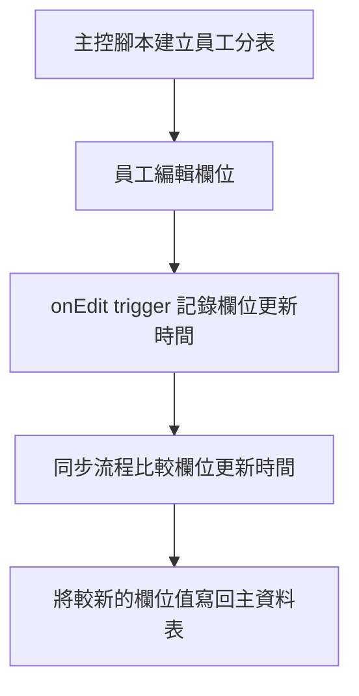

# 試算表專案追蹤同步

讓多人透過各自工作表更新資料，再依欄位的最後更新時間同步回主資料表，避免不同人編輯不同欄位時互相覆蓋。

## 同步流程

## 架構

- **主控腳本：**建立員工分表並執行資料同步。
- **員工工作表：**提供分開的資料編輯範圍。
- **`onEdit` trigger：**記錄被修改欄位的更新時間。
- **共用函式庫：**依欄位更新時間判斷應採用的值。
- **主資料表：**保存同步後的整合資料。

## 技術與設計

- **設計：**採欄位級最後更新優先，避免整列覆寫造成不同欄位的更新互相覆蓋。
- **技術：**Google Sheets、Google Apps Script（JavaScript）、安裝型 `onEdit` trigger。
