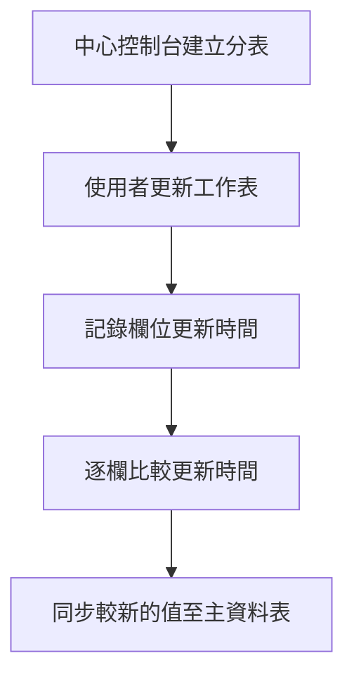

# 試算表專案追蹤同步

獨立設計與開發專案追蹤工具，以主表作為中心控制台，管理分表並彙整各使用者更新的資料。

## 同步流程

以欄位為單位判斷最後更新，降低多人更新同一筆資料的不同欄位時互相覆蓋的風險；同一欄位則依記錄的更新時間決定採用的值。

例如，A 更新進度、B 更新負責人時，可分別保留兩個欄位的最新值。

**技術：**Google Sheets、Google Apps Script、安裝型 onEdit 觸發器。
