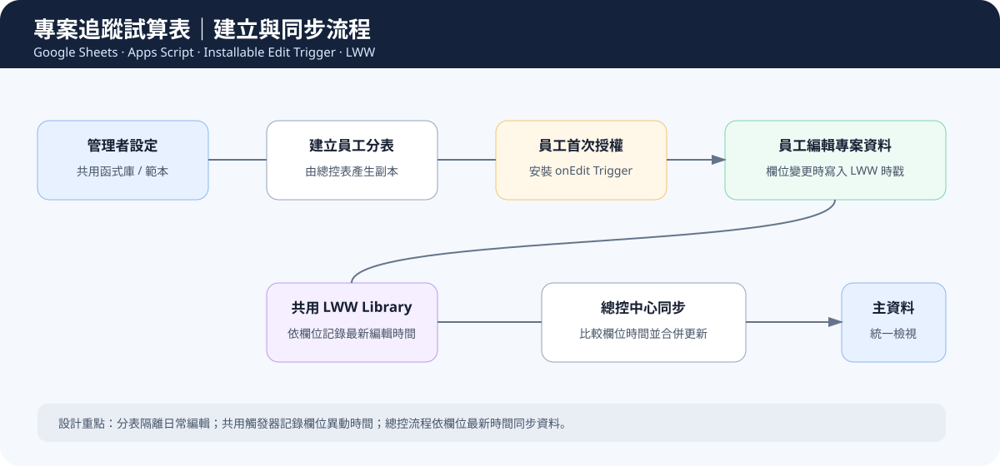

# 試算表專案追蹤同步

**技術：** Google Sheets、Google Apps Script（JavaScript）。

## 專案定位

員工分別更新工作表後，主控流程依欄位級最後更新時間將資料同步回主資料。

## 架構重點

員工範本建立分表；共用 LWW Library 透過安裝型 `onEdit` trigger 記錄編輯時間；主控腳本建立分表並執行同步。

## 流程圖

## 後續優化方向（設計建議）

- 定義欄位時間戳相同時的決勝規則，並記錄同步來源與結果。
- 採用批次讀寫、失敗重試與配額監控，控制 Apps Script 執行時間及呼叫量。

English: A Google Sheets and Apps Script workflow for field-level change tracking and synchronization.
