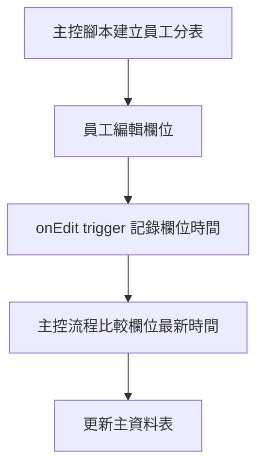
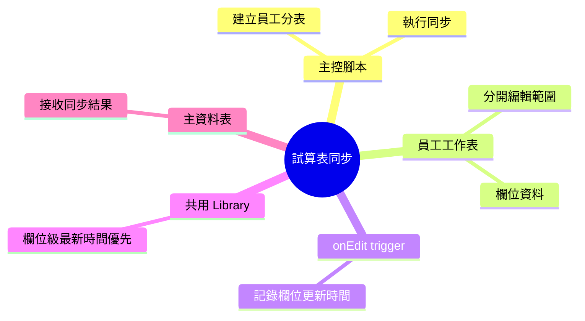

# 試算表專案追蹤同步

讓多人透過各自工作表更新資料，並依欄位更新時間同步回主資料表。

## 同步流程

## 架構心智圖

## 設計與技術

- **設計重點：** 以欄位級更新時間判定較新的值，避免整列覆寫造成不同欄位更新互相覆蓋。
- **技術：** Google Sheets、Google Apps Script（JavaScript）、安裝型 `onEdit` trigger。
